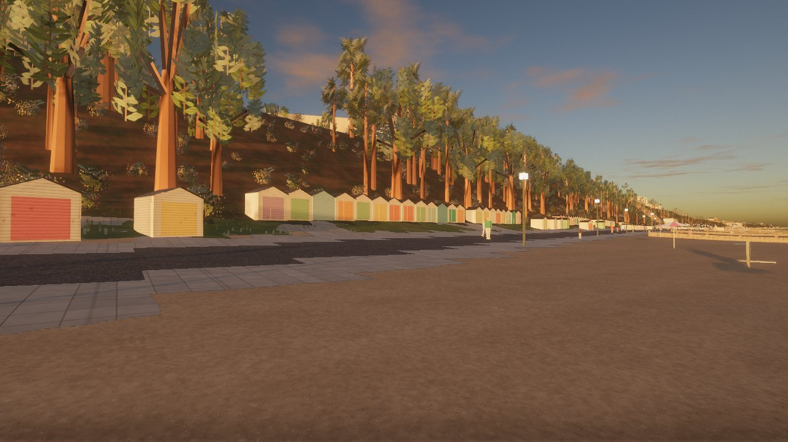
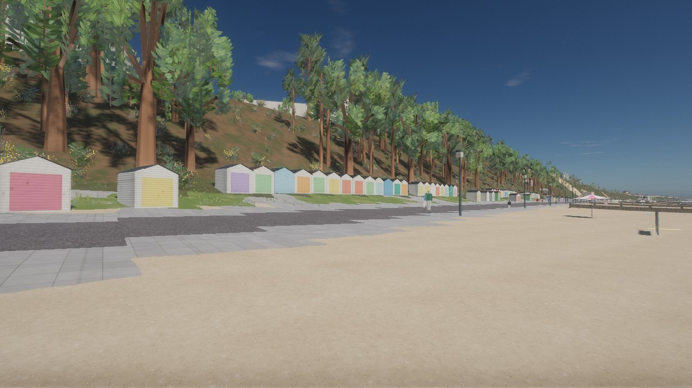
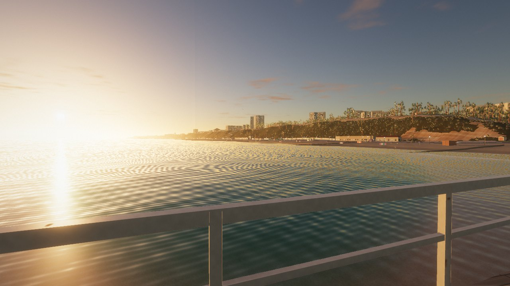
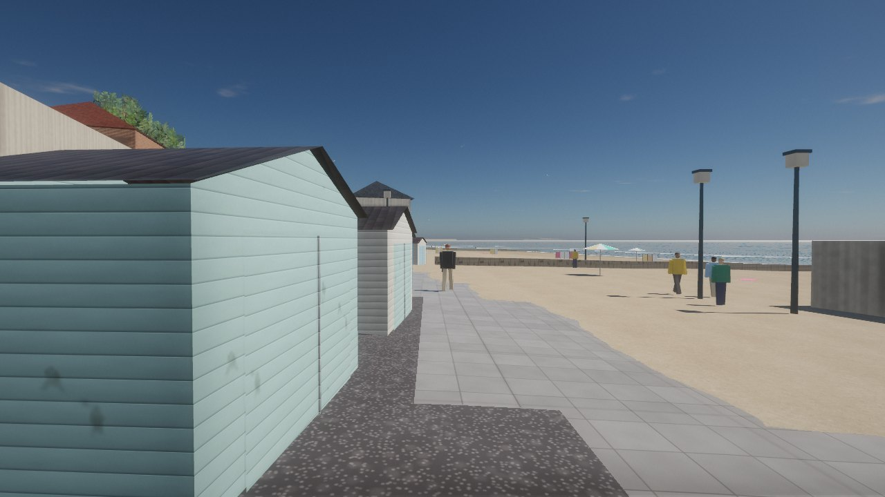
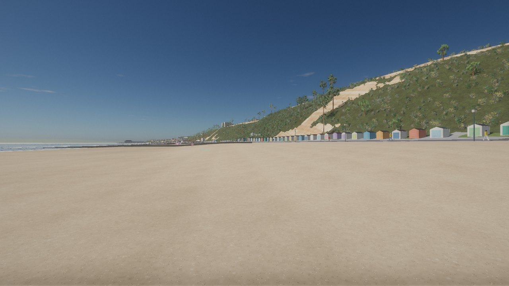

# Bournemouth Walk

**Ein Spaziergang an der echten Promenade von Bournemouth Pier nach Boscombe Pier – direkt im Browser.**

Die Küste ist aus echten Daten gebaut: das Gelände aus Höhendaten mit rund 3 m Auflösung, Gebäude, Strandhütten,
Piers, Wege, Bänke, Wälder und Heideflächen aus OpenStreetMap. Licht, Himmel, Meer und alle Materialien entstehen
im Browser, ohne Bilder, 3D-Modelle oder Sounddateien. Alles steckt in **einer einzigen HTML-Datei von rund 700 kB**.



Inspiriert von [Abyssal Garden](https://github.com/Noniv/abyssal-garden): gleiche Bauweise (reines WebGPU, keine
Engine, alles gebündelt in eine `index.html`).

## Ausprobieren

**Direkt im Browser spielen: [barrick89.github.io/BournemouthWalk](https://barrick89.github.io/BournemouthWalk/)**

Oder offline: [`index.html`](index.html) herunterladen und in **Chrome** oder **Edge** auf einem Desktop-Rechner öffnen.
Benötigt WebGPU und eine einigermaßen aktuelle Grafikkarte.

## Was es unterwegs zu sehen gibt

Der Weg folgt der Uferlinie rund **2,5 km** nach Osten:

- **Bournemouth Pier** mit seinem echten Grundriss, dem Restaurant und dem RockReef-Gebäude am Pierkopf
- die **Pier Approach** mit Oceanarium und Bournemouth International Centre
- **East Cliff** mit dem Russell-Cotes-Museum oben auf der Klippe, der **East Cliff Zig Zag**
- **Undercliff Drive**: die Promenade am Fuß der Klippen, mit Strandhütten, Laternen, Bänken und Buhnen
- Klippen in ihrer echten Form und Höhe (bis rund 38 m), bewachsen mit Kiefern, Ginster und Heide, mit offenen Sandsteinstellen
- **Toft Zig Zag**, Boscombe Chine, das **Overstrand**-Gebäude
- **Boscombe Pier** mit seinem echten Grundriss – das Ziel
- in der Ferne **Old Harry Rocks** und die Purbeck Hills, die **Isle of Wight** mit den Needles, Hengistbury Head
- drei Tageszeiten (`T`): Morgen, Mittag und Abend mit Sonnenuntergang über Purbeck
- Spaziergänger auf der Promenade und am Wasser, Möwen, Segelboote
- eine live erzeugte Geräuschkulisse: Brandung im Takt der sichtbaren Wellen, Wind, Möwen, Schritte je nach Untergrund

Unten zeigt eine Leiste, wie weit es noch bis Boscombe Pier ist. Wer ankommt, bekommt Zeit und Strecke angezeigt.

| | |
|---|---|
|  |  |
|  |  |

## Steuerung

| | Tastatur & Maus |
|---|---|
| Umsehen | Maus bewegen |
| Gehen | `W` `A` `S` `D` oder Pfeiltasten |
| Laufen | `Shift` halten |
| Springen | `Leertaste` |
| Tageszeit wechseln | `T` |
| Aussichtspunkte | `1` bis `5` (Start, Bournemouth-Pierkopf, East Cliff Zig Zag, Strand, Boscombe Pier) |
| Ton an / aus | `M` |
| Leistungsanzeige | `H` |
| Menü | `Esc` |

Promenade, Strand, Piers und Buhnen sind begehbar, auch die Wege und Treppen die Klippen hinauf. Gebäude, Hütten,
Laternen und Geländer sind fest, die steilen Klippenhänge kommt man nicht hinauf. Schwimmen geht nicht – bis zu den
Knien ins Wasser aber schon.

**Auf dem Touchscreen:** einen Finger halten zum Gehen und wischen zum Umsehen, ein zweiter Finger zum Laufen.

## Detailstufen

**Niedrig**, **Mittel** und **Hoch** im Menü (lädt die Seite neu). Niedrigere Stufen zeigen weniger Bäume, Büsche,
Gras und Menschen, nutzen kleinere Schattenkarten und verzichten (Niedrig) auf Kantenglättung. Läuft es zu langsam,
senkt das Spiel die Auflösung automatisch.

## Wie es funktioniert

**Daten** ([`tools/`](tools)): Die Höhendaten kommen als Terrain Tiles (Zoom 15, ~3 m), die Kartendaten aus
[Overture Maps](https://overturemaps.org) (aufbereitete OpenStreetMap-Daten). `build_world.py` macht daraus eine
kompakte Datei (`source/data/world.bin`, ~440 kB): zwei Höhenraster (3 m entlang der Küste, 8 m für die Umgebung),
eine Oberflächenkarte (Strand, Promenade, Straßen, Wege, Gärten, Wald, Heide, Klippe), rund 7500 Gebäudegrundrisse
mit Höhe, Stockwerken und Dachform, die Strandhütten, die Pier-Umrisse, Bänke, Mauern, Zäune, Bäume und die
Mittellinie der Promenade.

**Grafik** ([`source/src`](source/src)), alles direkt mit **WebGPU**:
- Himmel aus einem physikalischen Atmosphärenmodell (Rayleigh, Mie, Ozon), daraus auch Umgebungslicht, Sonnenfarbe und Dunst
- Wolkenschicht mit Wolkenschatten, drei Schattenkaskaden, Umgebungsverdeckung (SSAO), Bloom, filmisches Tonemapping
- physikalisch basiertes Licht (GGX) mit einer Materialbibliothek, die beim Laden auf der Grafikkarte gemalt wird:
  Sand, Pflaster, Asphalt, Sandstein, Backstein, Putz, Dachziegel, Schiefer, Planken, gestrichene Bretter, Rinde …
- Meer mit Wellen, Lichtbrechung, Wasserfarbe je nach Tiefe, Sonnenglitzern, Brandung und Spülsaum
- Kiefern, Laubbäume, Ginster und Heide aus Blätterkarten mit Alpha-to-Coverage, Gras um die Kamera herum

**Was angenähert ist:** OpenStreetMap kennt nur einen Teil der Strandhütten am Undercliff Drive; wo keine eingetragen
sind, stellt das Spiel Reihen an den landseitigen Rand der Promenade. Die Buhnen stehen in regelmäßigen Abständen,
nicht an ihren echten Positionen, und der Meeresboden ist ein gleichmäßiges Profil (die Höhendaten enthalten keine
Wassertiefen). Gebäude bekommen Fassaden und Dächer nach Typ, nicht ihr echtes Aussehen.

## Selbst anpassen

Zum Neubauen von `index.html` braucht es [Node.js](https://nodejs.org) 18 oder neuer:

```bash
cd source
npm install
npm run build            # minifiziert
npm run build:readable   # unminifiziert, zum Debuggen
```

Die Kartendaten neu erzeugen (Python 3 mit `numpy pillow shapely pyarrow requests`):

```bash
cd tools
python fetch_dem.py
python fetch_overture.py infra land landuse water seg bld land_cover
python build_world.py
```

| Datei | Inhalt |
|---|---|
| [`tools/build_world.py`](tools/build_world.py) | Aufbereitung der Höhen- und Kartendaten zu `world.bin` |
| [`source/src/data.js`](source/src/data.js) | Entpackt die Daten: Bodenhöhe, Oberfläche, Uferlinie, Promenade |
| [`source/src/world.js`](source/src/world.js) | Baut die Welt: Gelände, Gebäude, Hütten, Piers, Buhnen, Möbel, Vegetation, Leben. **Guter Einstieg.** |
| [`source/src/shaders.js`](source/src/shaders.js) | Atmosphäre, Licht, Gelände, Objekte, Vegetation, Meer, Nachbearbeitung (WGSL) |
| [`source/src/textures.js`](source/src/textures.js) | Die prozedurale Materialbibliothek und die Blätterkarten |
| [`source/src/main.js`](source/src/main.js) | Renderer, Kamera, Gehen und Kollision, Tageszeiten, HUD, Menü |
| [`source/src/audio.js`](source/src/audio.js) | Die Geräuschkulisse |

## Datenquellen und Lizenzen

- Kartendaten © [OpenStreetMap](https://www.openstreetmap.org/copyright)-Mitwirkende, verfügbar unter der
  [Open Database License (ODbL)](https://opendatacommons.org/licenses/odbl/), bezogen über
  [Overture Maps](https://docs.overturemaps.org/attribution/). Die abgeleitete Datei `source/data/world.bin`
  (und die darin eingebetteten Daten in `index.html`) steht ebenfalls unter der ODbL.
- Höhendaten: [Terrain Tiles](https://registry.opendata.aws/terrain-tiles/) (Mapzen, Amazon Web Services), siehe die
  [Quellenangaben der Höhendaten](https://github.com/tilezen/joerd/blob/master/docs/attribution.md).
- Der Code steht unter der [MIT-Lizenz](LICENSE).
